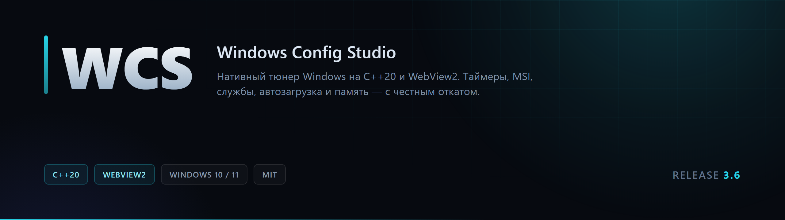
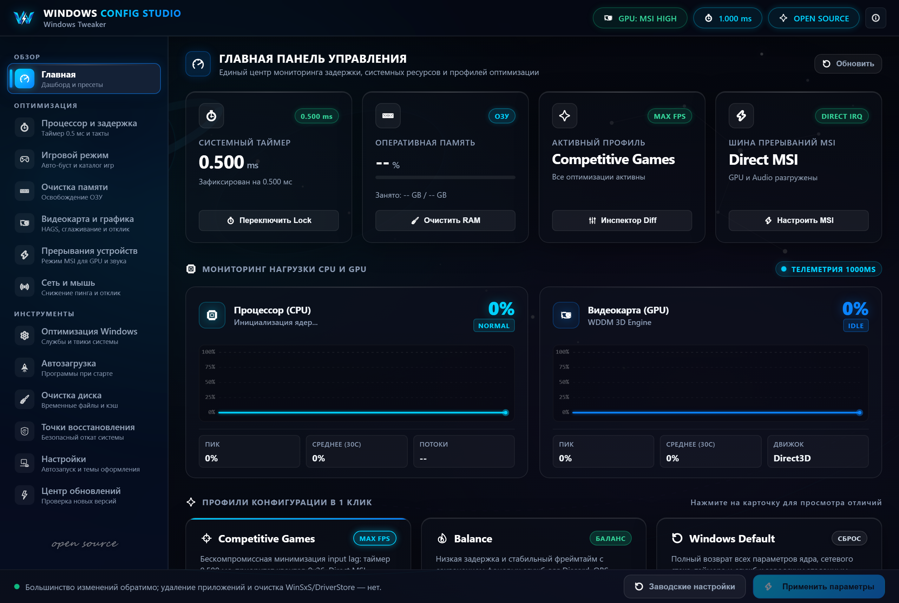
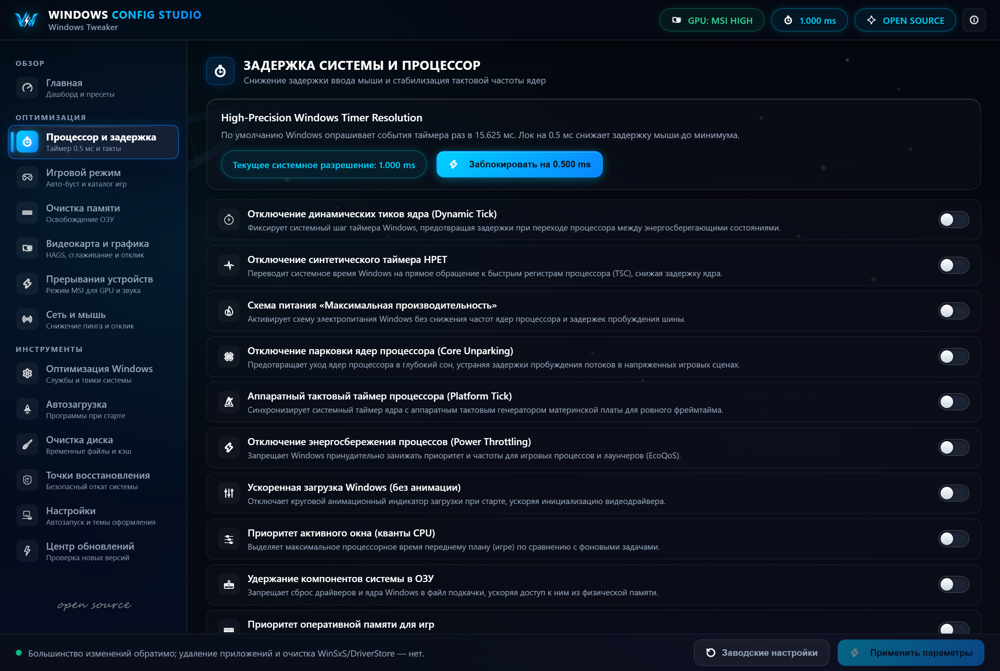
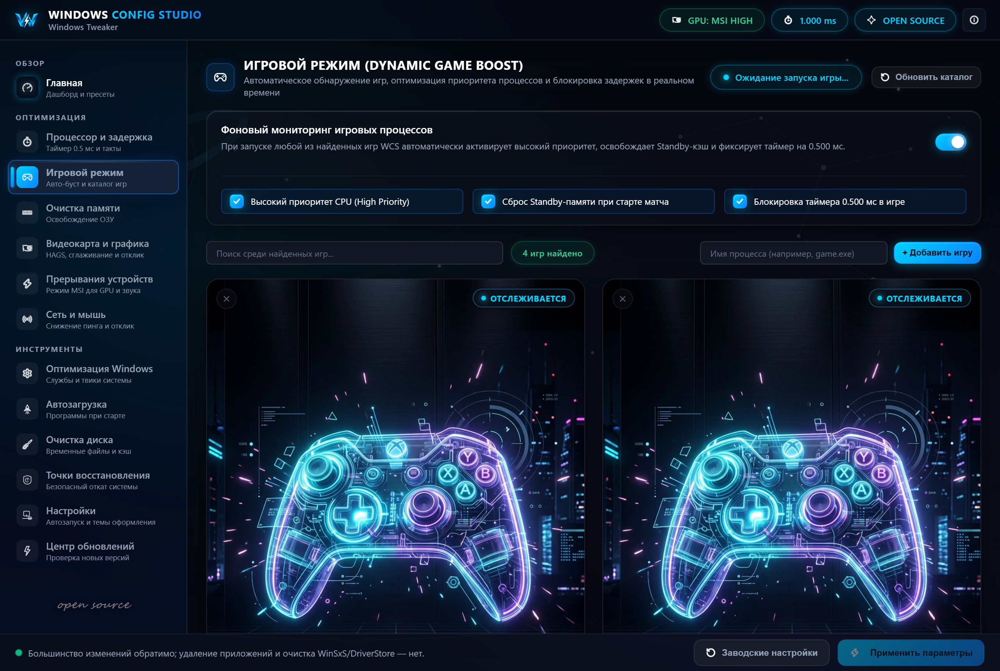
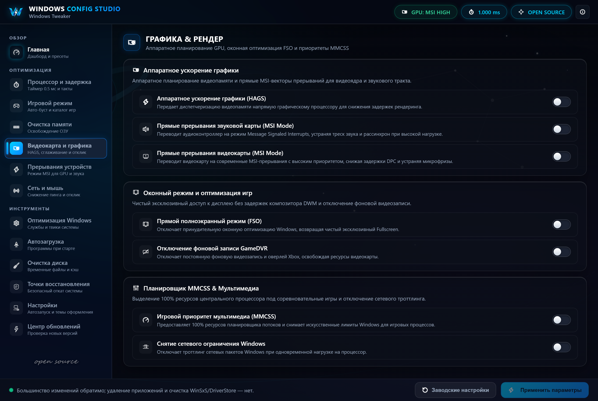
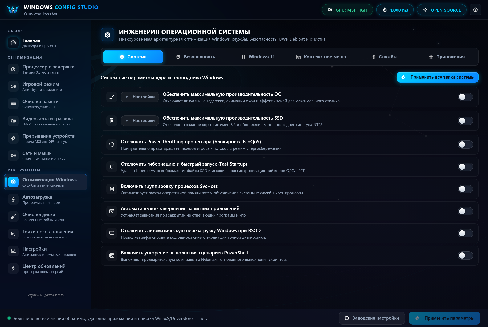
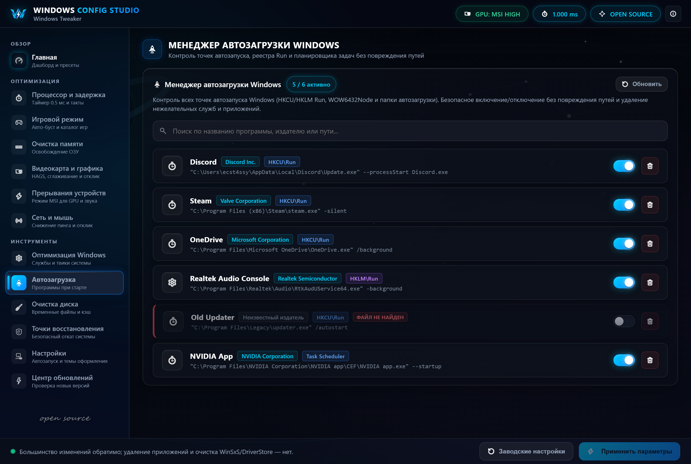

<div align="center">
  
</div>

<br>

<div align="center">

[](https://github.com/ext3ndedsoft/windows-config-studio/actions/workflows/build.yml)
[](https://github.com/ext3ndedsoft/windows-config-studio/releases)
[](#требования)
[](https://en.cppreference.com/w/cpp/20)
[](LICENSE)

</div>

---

**Windows Config Studio** — нативный тюнер Windows на C++20 и WebView2. Не Electron, не .NET, не обёртка над чужими скриптами: прямой WinAPI, реестр, SetupAPI и один процесс, который можно закрыть.

Интерфейс живёт в WebView2, но вся работа с системой идёт в нативном слое. Каждое изменение записывается в журнал откатов до применения — если что-то пошло не так, возвращается ровно то значение, которое было.

<br>

## Содержание

- [Скриншоты](#скриншоты)
- [Возможности](#возможности)
- [Честные ограничения](#честные-ограничения)
- [Архитектура](#архитектура)
- [Сборка](#сборка)
- [Релизы](#релизы)
- [Документация](#документация)
- [Лицензия](#лицензия)

<br>

## Скриншоты

| Дашборд | Процессор и задержка |
|:---:|:---:|
|  |  |
| Сводка по системе, живые графики и профили в один клик | Таймер, такты, приоритеты и парковка ядер |

| Игровой режим | Графика |
|:---:|:---:|
|  |  |
| Авто-детект игр и точечные настройки под запуск | MSI, HAGS, слаживание и отклик ввода |

| Оптимизация Windows | Автозагрузка |
|:---:|:---:|
|  |  |
| Реестр, службы и сетевые параметры с обратным ходом | Программы при старте, время загрузки, влияние |

<br>

## Возможности

**Задержка и планировщик**

- Аппаратный таймер `0.500 ms` с фиксацией на время игры и автоматическим снятием
- `disabledynamictick`, платформенный счётчик, кванты планировщика
- Приоритеты процессов и `Win32PrioritySeparation` с точным откатом
- Парковка ядер — без подмены минимальной частоты процессора

**Прерывания (MSI)**

- Перевод устройств на message-signaled interrupts через SetupAPI
- Применение только к устройствам, чей драйвер сам объявил поддержку MSI
- Накопители и USB-контроллеры исключены по умолчанию
- Ручной режим с явным подтверждением для остальных классов

**Игровой режим**

- Автопоиск установленных игр по библиотекам Steam, Epic, Riot и локальным каталогам
- Повышение приоритета, сброс standby-кэша и фиксация таймера на время матча
- Полное возвращение состояния после выхода из игры

**Система**

- Службы, телеметрия, деблоат Windows 11, контекстное меню, виджеты, Copilot
- Сетевые параметры: Nagle, подтверждения TCP, авто-подстройка окна, MTU по физическим адаптерам
- Очистка памяти с проверкой привилегий и честным отчётом о результате
- Автозагрузка, точки восстановления, очистка диска
- Пять тем оформления и пять фоновых сцен

<br>

## Честные ограничения

Проект делает то, что делает, и не приписывает себе большего.

- **Часть твиков — легаси.** Они остаются в интерфейсе, но помечены как неактуальные для современных Windows. Полный разбор каждого твика — в [docs/TWEAKS.md](docs/TWEAKS.md).
- **Телеметрия не выключается полностью на Home и Pro.** `AllowTelemetry=0` эти редакции молча приводят к `1`. Диапазон `0` работает на Enterprise и Education.
- **Глобального выключателя Fullscreen Optimizations не существует.** WCS ставит ближайший рабочий аналог и говорит об этом прямо.
- **MSI — не всегда.** Если драйвер не заявил поддержку, включение не применяется. Это защита, а не недоработка.
- **Никаких заявлений про античит.** Приложение не инжектит в чужие процессы, но это не гарантия и не обещание — формулировки вроде «100% Anti-Cheat Safe» были убраны.
- **Нужны права администратора.** Без них приложение запустится, но большинство действий вернёт отказ.
- **Действия с удалением необратимы.** Удаление приложений и очистка WinSxS/DriverStore не откатываются — интерфейс предупреждает об этом до нажатия.

<br>

## Архитектура

```
src/
├── core/            системная информация, конфиг, откаты, обновления, таймер
├── tweaks/          твики реестра, службы, MSI, память, автозагрузка, game boost
├── ui/              окно WebView2, нативный мост, точка входа
└── app.rc           иконка, версия, встроенный бандл ресурсов

resources/web/       интерфейс: HTML, CSS, JS (встраивается в exe при сборке)
third_party/         WebView2 SDK, nlohmann/json
tools/uilab/         локальная лаборатория для отрисовки интерфейса без сборки
docs/                разбор твиков, скриншоты, брендинг
```

Мост между слоями — один JSON-канал:

```jsonc
// запрос
{ "id": 1, "action": "applyTweak", "params": { "id": "tcpNoDelay" } }

// ответ
{ "id": 1, "action": "applyTweak", "success": true, "data": {}, "error": null }

// событие
{ "event": "timerStateChanged", "data": { "resolution": 0.5 } }
```

Тяжёлые операции (скан устройств, очистка памяти, поиск игр) выполняются в отдельной очереди воркера, чтобы интерфейс не ждал. Ресурсы интерфейса отдаются через виртуальный хост `https://wcs.local/` с проверкой origin.

<br>

## Требования

- Windows 10 1809+ или Windows 11 (x64)
- [WebView2 Runtime](https://developer.microsoft.com/microsoft-edge/webview2/) — на Windows 11 уже установлен
- Visual Studio 2022 с рабочей нагрузкой «Разработка классических приложений на C++»
- CMake 3.21+ и Ninja

## Сборка

```powershell
cmake -B build -G Ninja -DCMAKE_BUILD_TYPE=Release
cmake --build build
```

Готовый файл: `build\bin\WCS.exe`. Ресурсы интерфейса упаковываются в `resources.pak` скриптом `scripts\pack_resources.ps1` и встраиваются в бинарник — рядом с exe ничего носить не нужно.

Отладочная сборка с консолью:

```powershell
cmake -B build -G Ninja -DCMAKE_BUILD_TYPE=Debug -DWCS_DEBUG_CONSOLE=ON
```

<br>

## Релизы

Версия живёт в `src/app_version.h` и `CMakeLists.txt`, отображается как `MAJOR.MINOR` — без третьего нуля.

```powershell
# поднять версию, собрать и поставить тег
powershell -File scripts\release.ps1 -Version 3.7 -Tag
```

Скрипт собирает бинарник, обновляет `app_version.h` и `CMakeLists.txt`, ставит тег и публикует релиз с хешем SHA256. Встроенная проверка обновлений смотрит на последний релиз этого репозитория через GitHub API, поэтому тег и заголовок релиза должны начинаться с номера версии (`3.7` / `WCS v3.7`).

В `.github/workflows` лежат два готовых workflow — сборка на каждый push и публикация релиза по тегу. Для их публикации требуется токен со scope `workflow`:

```powershell
gh auth refresh -s workflow
```

<br>

## Документация

| Документ | Что внутри |
|---|---|
| [docs/TWEAKS.md](docs/TWEAKS.md) | Каждый твик: что пишет, что читает Windows, что делает откат, статус |
| [CHANGELOG.md](CHANGELOG.md) | История версий |
| [tools/uilab](tools/uilab) | Лаборатория интерфейса: `node tools/uilab/server.js 8732` |

<br>

## Лицензия

[MIT](LICENSE). Используйте на свой риск: приложение меняет системные настройки и работает с правами администратора.